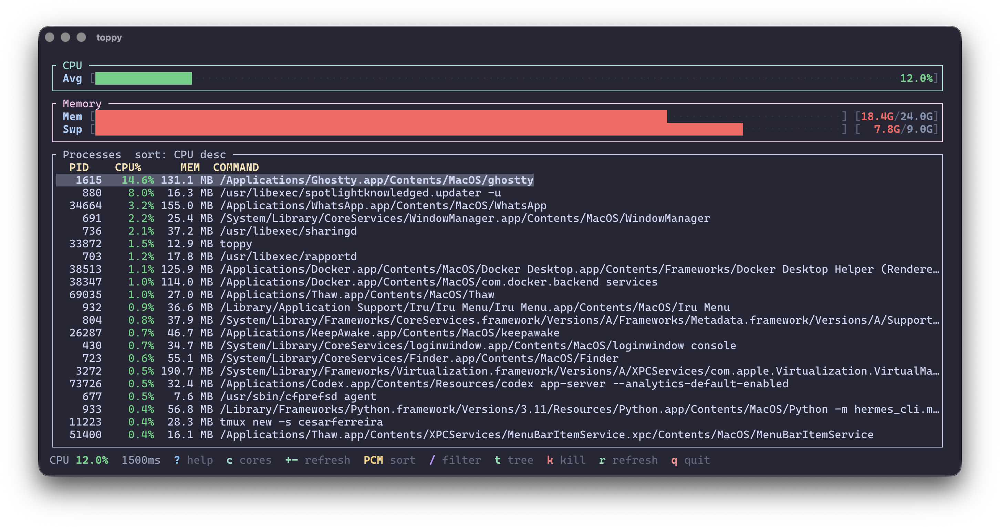

<div align="center">
  <h1>toppy</h1>

  <p><strong>A fast, colorful terminal system monitor — process-focused, keyboard-driven, built in Rust.</strong></p>

  <p>
    
    
    
    <a href="https://crates.io/crates/toppy"></a>
  </p>

  <p>
    <a href="#install">Install</a>
    &nbsp;·&nbsp;
    <a href="#quickstart">Quickstart</a>
    &nbsp;·&nbsp;
    <a href="#footprint">Footprint</a>
    &nbsp;·&nbsp;
    <a href="#keybindings">Keybindings</a>
    &nbsp;·&nbsp;
    <a href="#development">Development</a>
  </p>

  <p>
    
  </p>
</div>

---

## Why toppy

Most system monitors try to show everything at once. **toppy** stays focused: which process is using CPU or memory, and how loaded the machine is right now.

It is a single binary TUI that puts **PID**, **CPU%**, and **Command** front and center, with colorful per-core CPU bars and memory/swap usage at a glance. The release binary is about **1.0 MB** with roughly **7 MB** idle RSS on macOS arm64 — fast to install, cheap to leave running (see [Footprint](#footprint)).

- **Process-first.** Wide command column, sortable PID/CPU/MEM, live filter, tree view.
- **Colorful at a glance.** Green → yellow → red utilization bars for CPU, RAM, and swap.
- **Keyboard-driven.** Sort, filter, kill, tree expand/collapse, help overlay — all from the keyboard.
- **Lean and responsive.** Rust + [ratatui](https://ratatui.rs) + [sysinfo](https://github.com/GuillaumeGomez/sysinfo). No configuration or mouse required; display preferences are saved automatically.
- **Cross-platform.** macOS and Linux.

<a id="footprint"></a>
## Footprint

Measured on **macOS arm64** from a release build (`cargo build --release`):

| | |
|---|---|
| **Release binary** | **~1.0 MB** (1,005,808 bytes) |
| **Debug binary** | ~6.0 MB (dev builds only) |
| **Idle RSS** | **~7 MB** (typical while running; ~730 processes on the test machine) |

RSS includes the process list held by `sysinfo`, so it grows slightly on machines with more processes. Virtual size on macOS is much larger and is not a useful “real memory” figure.

To reproduce:

```bash
cargo build --release
ls -lh target/release/toppy
# run toppy, then in another terminal:
ps -o rss,command -p $(pgrep -n toppy)
```

## Install

Requires [Rust](https://rustup.rs) **1.85+** and `~/.cargo/bin` on your `PATH`.

```bash
cargo install toppy
```

Verify:

```bash
toppy --help
```

<details>
<summary><strong>Build from source</strong> — for development or unreleased changes</summary>

```bash
git clone https://github.com/cesarferreira/toppy.git
cd toppy
cargo install --path . --locked
# or
make install-release
```

Debug install (faster compile, larger binary):

```bash
make install
```

Run without installing:

```bash
make build-release
./target/release/toppy
```

</details>

<a id="quickstart"></a>
## Quickstart

Launch the monitor:

```bash
toppy
```

Custom refresh interval (default `1500` ms):

```bash
toppy --refresh-rate 2000
```

Use `+` / `-` while running to adjust the interval (200 ms–10 s).

From the process list:

```bash
# Sort by CPU (default), filter by name, open tree view
# P / C / M / T  → sort columns
# /chrome        → filter processes
# t              → tree view
# k              → kill selected process
# q              → quit
```

## Highlights

### Per-core CPU

The default is a single average CPU bar. Press lowercase `c` to show one labeled bar per logical core with live utilization and color-coded severity:

```
C0  [████████░░░░░░░░░░] 42.3%
C1  [██████████░░░░░░░░] 51.1%
```

### Memory and swap

RAM and swap usage with human-readable **KB / MB / GB** labels, used/total, and percentage bars.

### Process table

Focused columns for the work you actually do in a monitor:

| PID | CPU% | MEM | COMMAND |
|-----|------|-----|---------|
| 1234 | 45.2 | 1.2 GB | `/Applications/Firefox.app/...` |

The command column uses the full remaining terminal width — no arbitrary truncation. Press lowercase `p` to switch between the full command line and just the program name; the choice is remembered across restarts.

By default, the cursor and viewport stay at the same row positions while rankings update underneath them. Stay at the top to watch the busiest processes without the screen chasing a previously selected process.

Press lowercase `f` to follow the selected process instead. Selection then follows its PID and start time across sorting and refreshes, scrolling when needed. A persistent **Following PID …** label identifies the target. Press `f` again to return to stationary rows at the current position. Navigation (`↑`/`↓`, page keys, `Home`/`End`), switching table/tree view, or editing the filter also stops following. Follow mode ends if the process exits, its PID is reused, or it is no longer visible; it is not saved across restarts. Help and the kill menu do not interrupt following.

### Process tree

Press `t` to switch the process panel to tree view. Expand and collapse branches with `→`, `←`, or `Enter`. Each node still shows PID, CPU%, MEM, and command.

Help, filtering, and the kill menu preserve the underlying tree view. Tree filtering shows matching processes and their ancestors, temporarily expanding those paths without changing saved expansion state.

### Kill and filter

- `/` — live filter on command name or PID
- `k` / `F9` — kill menu (`1` = SIGTERM, `2` = SIGKILL)
- `?` / `F1` — help overlay

The kill menu captures the selected PID and start time when opened, so refreshes cannot change the target. Before sending a signal, toppy re-reads the process and refuses if it exited or its start time changed. This is a best-effort identity check, not an atomic OS process handle: start-time resolution and the small check-to-signal race still apply.

Metrics continue refreshing while you navigate or use overlays; keyboard input does not reset the refresh deadline.

<a id="keybindings"></a>
## Keybindings

| Key | Action |
|-----|--------|
| `q` | Quit |
| `Ctrl-C` | Quit, including from overlays |
| `↑` / `↓` | Move selection |
| `f` | Toggle following the selected process |
| `PgUp` / `PgDn` | Page up/down |
| `Home` / `End` | First/last row |
| `P` / `C` / `M` / `T` | Sort by PID / CPU / MEM / Command |
| `/` | Filter by command or PID |
| `Esc` | Clear filter / close overlay |
| `p` | Toggle full command line / program name |
| `c` | Toggle average / per-core CPU view |
| `t` | Toggle process tree view |
| `→` / `←` / `Enter` | Expand/collapse tree node |
| `k` / `F9` | Kill selected process |
| `?` / `F1` | Help overlay |
| `+` / `-` | Slower / faster refresh |
| `r` | Force refresh |

In the kill menu: `1` = SIGTERM, `2` = SIGKILL.

In the filter: `Enter` keeps the filter and closes input; `Esc` clears it and closes input. Outside overlays, `Esc` clears the active filter. Uppercase `P` / `C` sort; lowercase `p` / `c` change display preferences.

## Saved preferences

CPU expansion and command display are saved to `$XDG_CONFIG_HOME/toppy/config.toml`, or `~/.config/toppy/config.toml` when `XDG_CONFIG_HOME` is unset. No file needs to be created manually.

```toml
cpu_cores_expanded = false
show_full_command = true
```

## CLI options

| Option | Default | Description |
|--------|---------|-------------|
| `--refresh-rate` | `1500` | Refresh interval in milliseconds |

<a id="development"></a>
## Development

Common tasks via the `Makefile`:

```bash
make              # check + build + test
make build        # debug build
make build-release
make install      # install debug binary
make install-release
make run ARGS="--refresh-rate 500"
make check        # cargo check + clippy
make fmt          # format
make lint           # fmt check + clippy
make test
make test-terminal # PTY regression tests; requires Python 3
make measure       # live collection, synthetic views, startup, idle CPU/RSS
make clean
make demo         # install + show --help
```

### Measuring performance

Measure before optimizing, using the same release profile, terminal size, refresh interval, and a similar process count on an otherwise quiet machine:

```bash
make measure-metrics   # collection p50/p95; sort/filter/tree at 100, 1k, 10k rows
make measure-footprint # 3 x 10-second samples in a 120x40 PTY, 1500ms refresh
# Or pass a custom binary, duration, and sample count:
python3 scripts/measure.py target/release/toppy --seconds 30 --samples 5
```

`measure.py` reports JSON with binary size, startup-to-first-frame latency, median idle RSS, and CPU as a percentage of one core. It uses `/proc` on Linux and `ps` on macOS. The example measures collection plus synthetic sorting, filtering, tree building, and flattening. An ignored release-mode test also measures full application snapshot processing with 10,000 expanded processes, excluding collection and rendering. Live measurements depend on host load and process count; they are observations, not CI performance thresholds.

Measurements on Linux x86_64 (8 logical CPUs), before and after the reliability changes:

| Measurement | Before (`b34d73c`) | After |
|---|---:|---:|
| Live processes | 322 | 320 |
| Collection p50 / p95 | 12.647 / 16.077 ms | 12.740 / 13.258 ms |
| Synthetic sort/filter/tree, 10k rows, p50 | 2.026 ms | 1.989 ms |
| Startup to first frame, median | 270.5 ms | 248.5 ms |
| Idle CPU, one core | 0.80% | 1.00% |
| Idle RSS, median | 4,194,304 bytes | 4,214,784 bytes |
| Release binary | 1,229,840 bytes | 1,238,432 bytes |

Footprint samples were 3 × 10 seconds at 1500 ms refresh in a 120×40 PTY. These are separate runs on a shared host, not proof of a speedup. A busier intermediate run reached 22.4 ms collection p50, illustrating why host load matters. During implementation, measuring the new expanded-state validation exposed quadratic searches: the full-app 10k-expanded-row workload went from 156.4 ms p50 to 4.4 ms after replacing them with identity-set lookups. That comparison is against the in-progress implementation, not the original release.

Releasing (requires [cargo-release](https://github.com/crate-ci/cargo-release)):

```bash
make release                  # default minor bump
make release LEVEL=patch      # patch bump
make release LEVEL=major      # major bump
```

The pre-release hook finalizes `CHANGELOG.md` from commits since the latest `v*` tag, refreshes compare links, and leaves a fresh `Unreleased` header. If there are no commits since the last tag, the release stops before publishing.

## Stack

| Component | Crate |
|-----------|-------|
| Language | Rust (edition 2024) |
| TUI | [ratatui](https://crates.io/crates/ratatui) |
| Terminal | [crossterm](https://crates.io/crates/crossterm) |
| System data | [sysinfo](https://crates.io/crates/sysinfo) |
| CLI | [clap](https://crates.io/crates/clap) |

## License

MIT
